<p align="center">
  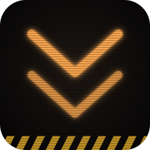
</p>

<p align="center">
  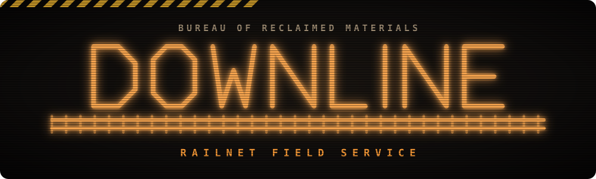
</p>

<p align="center">
  <b>A co-op horror scavenger.</b><br>
  Ride the Bureau's train down the line, strip dead facilities for scrap,<br>
  and get back aboard before the dark gets you.
</p>

<p align="center">
  <a href="https://github.com/Demiffy/downline/releases/latest">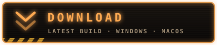</a>
</p>

<p align="center">
  <sub><b>WINDOWS &amp; MACOS</b> &nbsp;·&nbsp; <b>SOLO OR A CREW OF UP TO 6</b> &nbsp;·&nbsp; <b>PROXIMITY VOICE</b> &nbsp;·&nbsp; <b>UPDATES ITSELF</b></sub>
</p>

<p align="center">
  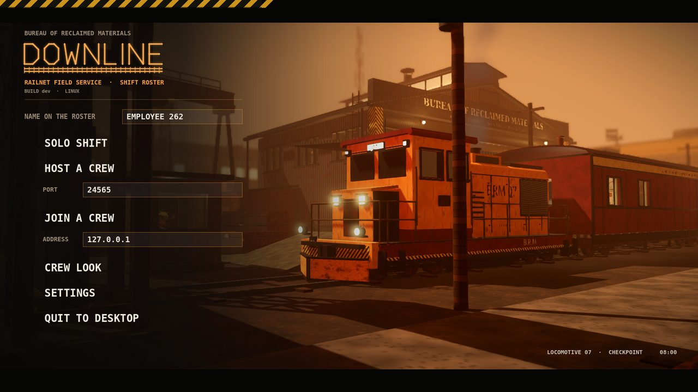
</p>

<p align="center"><sub><i>Made in Godot 4.7 with GDScript and no asset files: every mesh, texture, sound and sign is made in code.</i></sub></p>


## The job

You work for the **Bureau of Reclaimed Materials**. You live on a small diesel train that runs between ruined surface stations. Under each station a mine-shaft lift goes down into a facility nobody has been in for years, full of scrap and of things that should not be there.

Haul the scrap back aboard before the train leaves at midnight, shred it at the checkpoint to meet the Bureau's quota, take the next assignment. Keep going until the line wins.

<table>
  <tr>
    <td width="50%">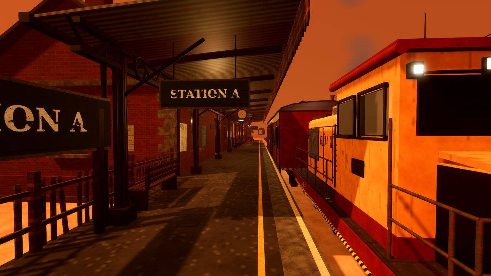<br><sub><b>THE STOP</b> · drawn up at the platform, the day ahead</sub></td>
    <td width="50%">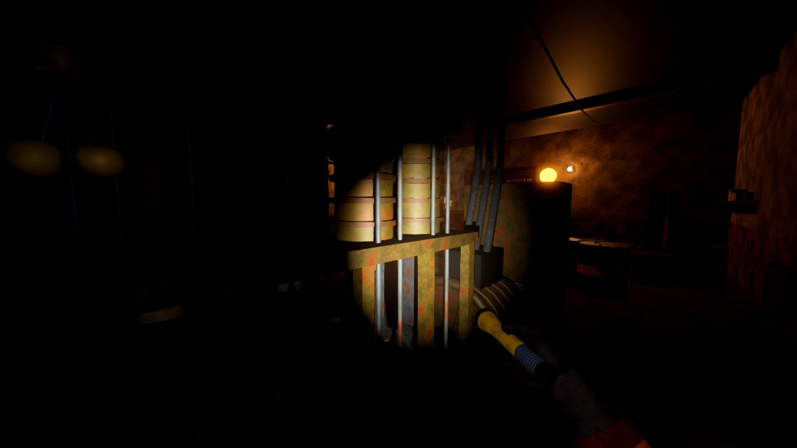<br><sub><b>DOWN BELOW</b> · sixty metres under, nobody's been in for years</sub></td>
  </tr>
  <tr>
    <td>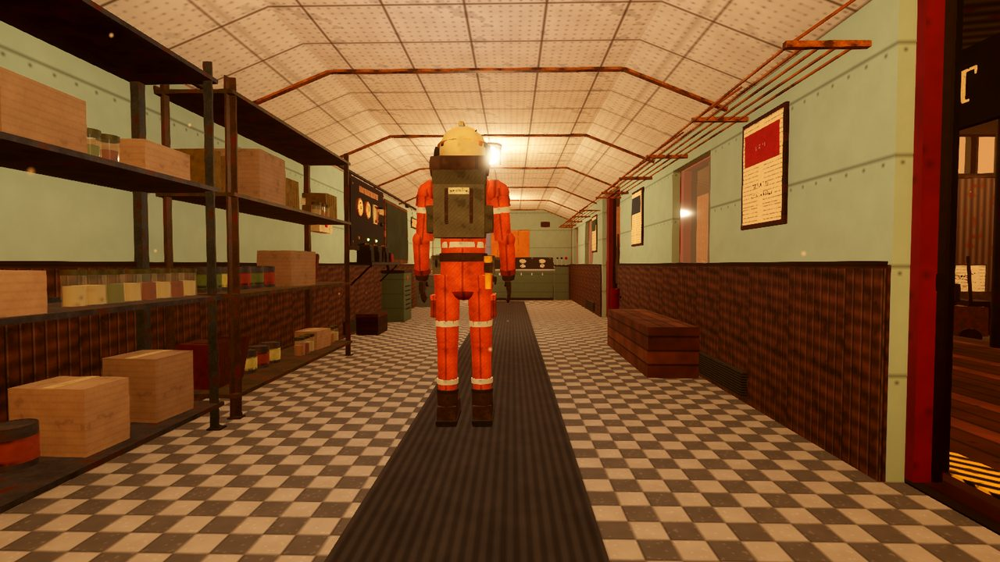<br><sub><b>HOME</b> · the crew car: terminal, charging rack, the clock</sub></td>
    <td>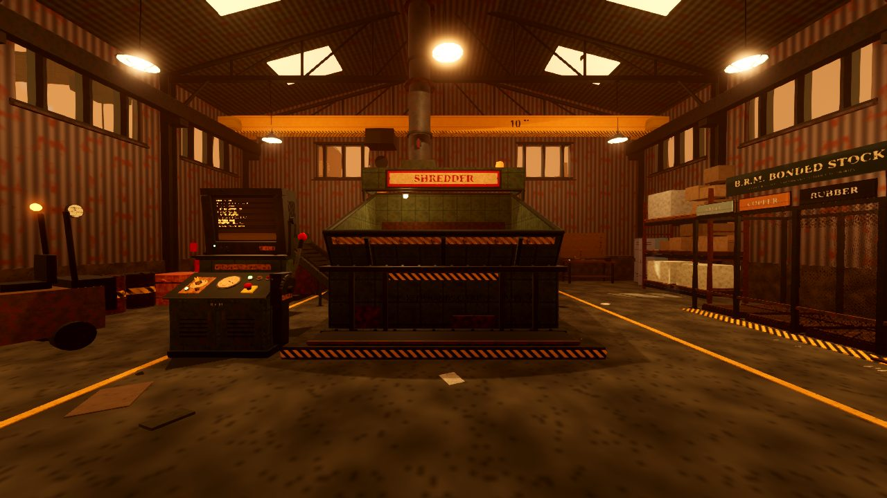<br><sub><b>THE CHECKPOINT</b> · where the scrap becomes the quota</sub></td>
  </tr>
</table>

<p align="center">
  <a href="#getting-the-game">Getting the game</a> &nbsp;·&nbsp;
  <a href="#playing-together">Playing together</a> &nbsp;·&nbsp;
  <a href="#how-a-shift-goes">How a shift goes</a> &nbsp;·&nbsp;
  <a href="#money-quotas-and-the-bureau">Money and the Bureau</a> &nbsp;·&nbsp;
  <a href="#whats-down-there">What's down there</a> &nbsp;·&nbsp;
  <a href="#the-sites">The sites</a> &nbsp;·&nbsp;
  <a href="#gear-and-upgrades">Gear</a> &nbsp;·&nbsp;
  <a href="#the-terminal">The terminal</a> &nbsp;·&nbsp;
  <a href="#controls">Controls</a> &nbsp;·&nbsp;
  <a href="#saves-and-settings">Saves and settings</a> &nbsp;·&nbsp;
  <a href="#for-developers">For developers</a>
</p>


## Getting the game

Download the zip for your system from the **[latest release](https://github.com/Demiffy/downline/releases/latest)**, unzip it anywhere, and run it. Nothing to install.

| | |
|---|---|
| **Windows** | Run `Downline.exe` (keep `Downline.pck` next to it). The exe isn't signed, so Windows may say *"Windows protected your PC"*: click **More info → Run anyway**. Allow it through the firewall (private networks) and let it use the microphone. |
| **macOS** | Drag `Downline.app` anywhere. It isn't notarised: the first time, right-click it → **Open** → **Open**. If macOS says it's damaged, run `xattr -dr com.apple.quarantine /Applications/Downline.app` once in Terminal. |

> [!TIP]
> **It updates itself.** Every launch checks the latest release and downloads the new game pack if there is one (a megabyte or so), while an old CRT boots up on screen. Mac and Windows players play together as long as they're on the same build; it's shown under the title.

## Playing together

The title screen has **SOLO SHIFT**, **HOST A CREW** and **JOIN A CREW**.

- **Host:** press HOST A CREW (port **24565** by default). For friends over the internet, forward **UDP 24565** on your router to your PC and give them your public IP. Press START THE SHIFT when everyone's in; latecomers are brought aboard wherever the train is.
- **Join:** type the host's address (`1.2.3.4` or `1.2.3.4:24565`) and press JOIN A CREW.
- **Voice** is proximity: your voice comes from your helmet, fades with distance, rings in the room, goes round corners through open doorways and dies behind walls. Things down there hear you when you're loud. Open mic by default; SETTINGS → AUDIO has push-to-talk (**V**), mic level and the gate. A **walkie-talkie** reaches anyone carrying one, at any range.
- The host runs the world: the creatures, the scrap, the clock and the money. Everyone sees the same station, down to the furniture.
- **CREW LOOK** on the title screen: your suit and helmet colours, a marking and a name patch.


## How a shift goes

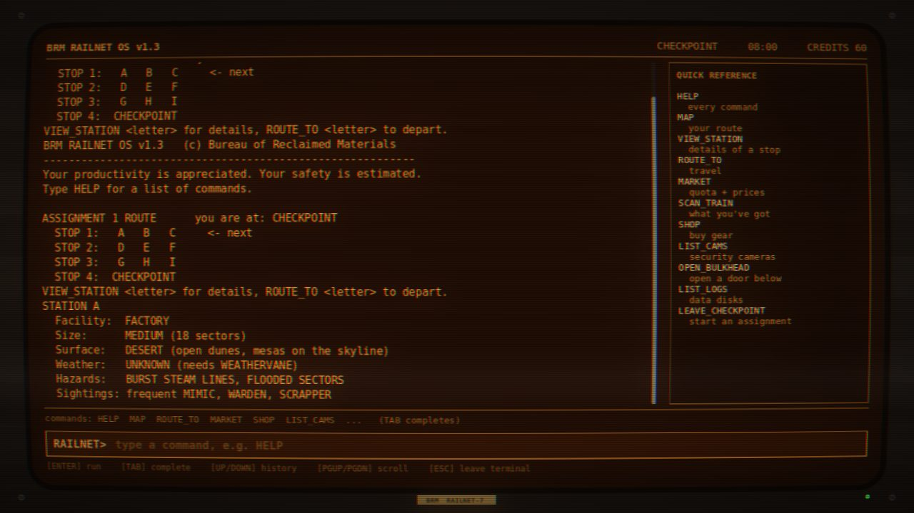

1. **At the checkpoint**, use the terminal at the front of the crew car and type `LEAVE_CHECKPOINT`. The Bureau issues an assignment: a quota of **steel, copper, rubber and plastic**, and a route of three stops, each with two or three stations to choose from.
2. **Pick a station.** `MAP` shows the route, `VIEW_STATION B` tells you what you'd be walking into (the facility, its size, the weather, its hazards and what tends to live there), and `ROUTE_TO B` sets off. The train pulls out, runs the line through the hills and a tunnel, and draws up at the next platform. Things happen on the way.
3. **Go down.** Follow the ELEVATOR signs from the station to the lift headframe and ride 60 m down. Find scrap, carry it back up, and put it **inside the train**: only what's aboard counts.
4. **Watch the time.** The day runs from 08:00 to midnight in twelve real minutes, with one warning two hours out. The train leaves at 24:00 with or without you. You can run for it as it pulls out; once it's 40 m away you're left behind (you're recovered at the next stop, without what you were carrying).
5. **Back at the checkpoint** after three stops, throw the scrap into the shredder's hopper and pull the **MAIN DRIVE** lever. Meet the quota and the gate opens. Leave without meeting it and the train rams the gate: that's the end of the run.

> [!NOTE]
> **Dying doesn't end the run.** A replacement wakes aboard an hour later. Your cargo is untouched, and your body lies where you fell with whatever you were holding. Carry it back aboard and the Bureau pays a small recovery fee. (It charges for the replacement, though.)

<table>
  <tr>
    <td width="50%">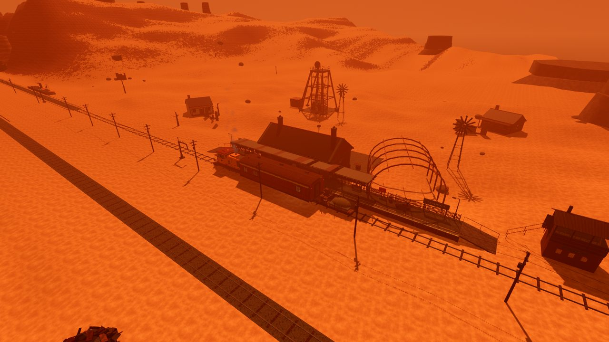<br><sub><b>THE LINE</b> · every stop sits in a valley between two tunnels</sub></td>
    <td width="50%">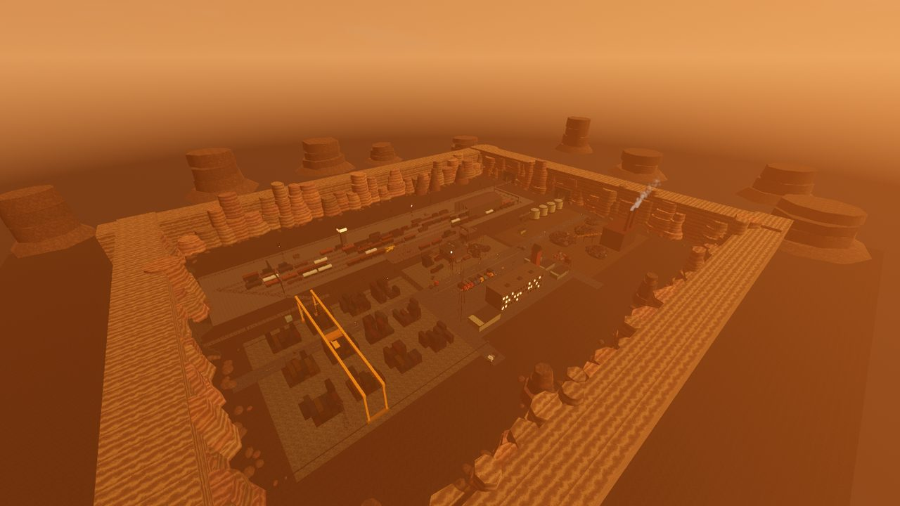<br><sub><b>THE CHECKPOINT</b> · the Bureau's yard, from the air</sub></td>
  </tr>
</table>

## Money, quotas and the Bureau

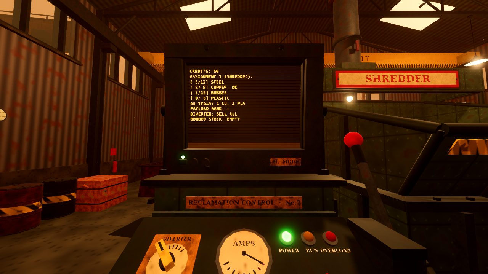

- **Shredding pays.** Each item is paid as it goes through the cutters, at the day's prices (`MARKET`); prices change every stop. Heavy scrap jams the cutters until they reverse and have another go.
- **The quota grows** with every assignment, faster as the run goes on, and with the size of the crew.
- **Payload rank:** shred more than the quota is worth for rank B, A or S and a one-off Bureau bonus. The **shift report** comes up stamped with your grade.
- **Replacements cost money.** Every death is docked from the crew's account, dearer each time this assignment, even into debt (you can't buy anything until the shredder has paid it off). Lose the whole crew at once and the Bureau recalls the train.
- **Sell or bank.** The **DIVERTER** on the shredder's desk: on **SELL** everything is paid out; on **BANK** whatever's past the quota goes into the Bureau's **bonded stock** instead, unpaid. The stock waits in a cage in the hall between assignments. Sell it later on a better day (`STOCK SELL`), or put it toward a quota that's grown too big (`STOCK SUBMIT`).

<table>
  <tr>
    <td width="50%">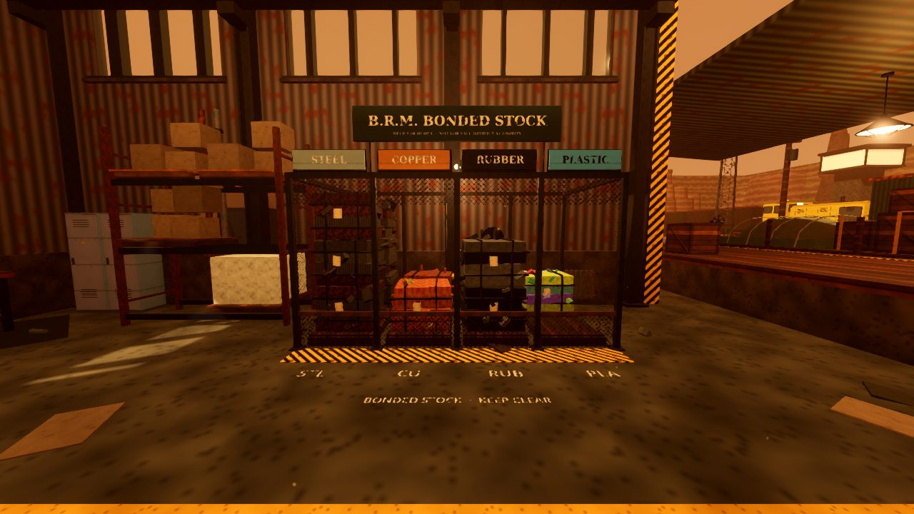<br><sub><b>BONDED STOCK</b> · a bale for every four units banked</sub></td>
    <td width="50%">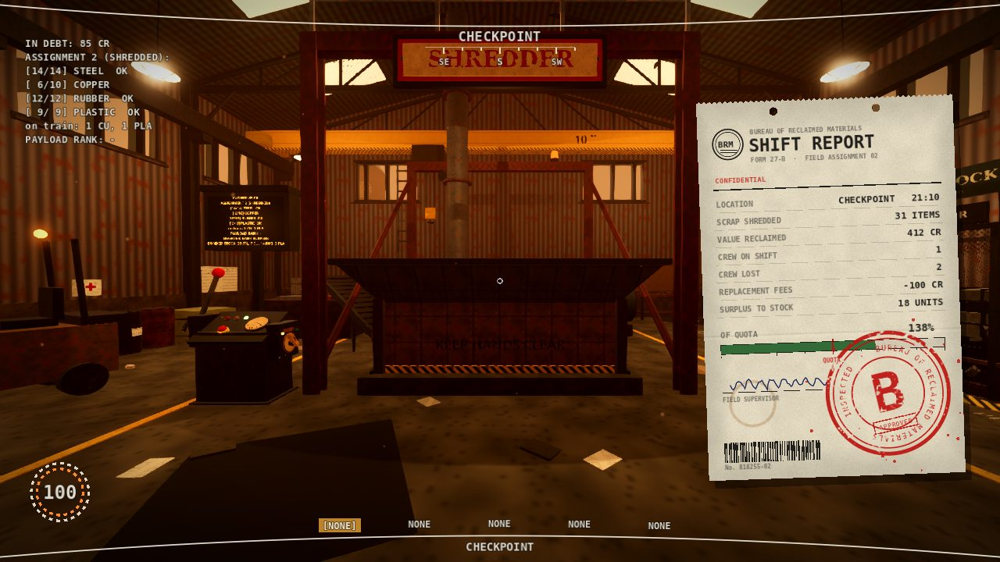<br><sub><b>SHIFT REPORT</b> · typed, totalled and stamped</sub></td>
  </tr>
</table>


## What's down there

Every creature has one rule, a tell and a way to live through it. Scanning one logs it in the **field guide** (`GUIDE` at the terminal).

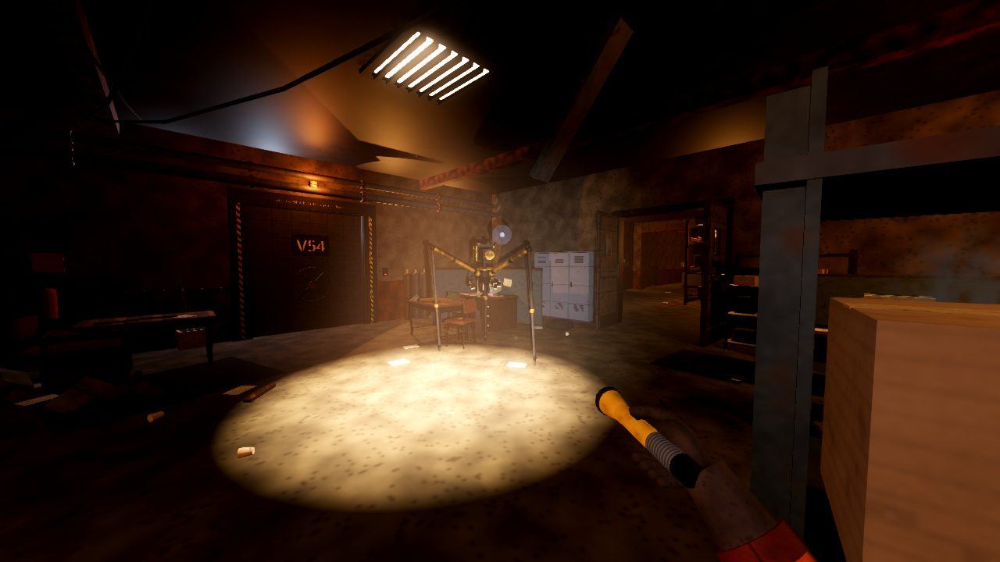

| | |
|---|---|
| **Pulsator** | A glowing sac on three arms. Blind: it hunts by sound and bursts when it reaches you. Crouch, keep quiet. |
| **Statue** | Moves only while nobody's looking at it. Keep your eyes on it, and stick together. |
| **Marionette** | Moves only *while* it's watched. Don't look. |
| **Mimic** | A barrel, until you're close enough to touch it. Look for the tells. |
| **Warden** | Sees only what its searchlight hits. Stay out of the beam; it can't climb. |
| **Observer** | A bellows camera on long legs that follows you, clicking. Look back and it flashes you blind, and leaves a photograph of you on the floor. |
| **Wraith** | A dead miner that carries the dark with it. Burn it off with a flashlight beam; a lantern holds it back. |
| **Siren** | Grey and eyeless. It bolts when it's seen, and calls to you in a crewmate's voice from where it can't be seen. |
| **Husk** | A body left too long in the dark gets up, looking just like one of your crew. The one thing missing is a name over its helmet. |
| **Snatcher** | The ceiling vent with blood dripping from it. Walk under it and you're somewhere else. |
| **Roomba** | Patrols with a laser tripwire. Break the beam and run. |
| **Leviathan** | Under the dunes, late in the day. When the ground rumbles, be silent or be under a roof. |
| **Scrapper** | A shy bug in a shell of junk. Catch it calm and the shell is worth a lot. |
| **Bear trap** | Holds you and hurts until someone pries it open. |
| **Gloe** | A friendly light. It picks one of you and lights the way. |

Weapons work on most of them (a crowbar, a fire axe, a shotgun); the statue is stone and the wraith is cloth and cold.

## The sites

**Up top, the country changes from stop to stop.** Every station sits in a valley of its own, and the line runs on through the same country to the next tunnel.

| | |
|---|---|
| **Desert** | Open dunes, mesas on the skyline, sandstorms. |
| **Arctic** | Snowfields and spruce, frozen ponds, blizzards. |
| **Forest** | Deep woods of oak, birch and spruce, ferns, fallen timber, cabins in the trees. |
| **Swamp** | Black water in the hollows, cypress hung with moss, reeds, a boardwalk on stilts out to the lift, shacks on piles. |
| **Dead town** | Cracked streets, the shells of brick and concrete buildings with the windows out, a bus, traffic lights, billboards, tower blocks on the skyline. |

<table>
  <tr>
    <td width="33%">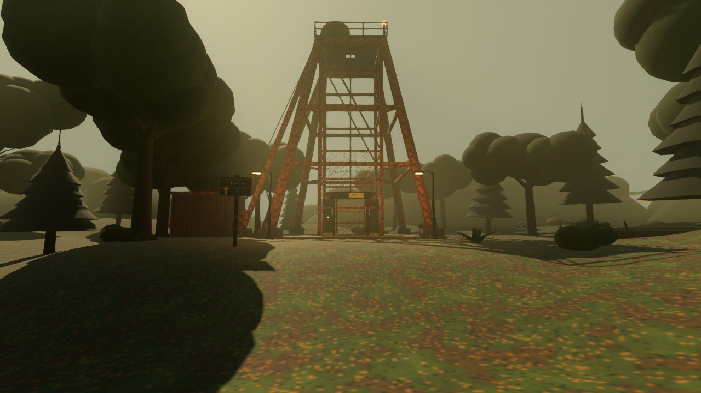<br><sub><b>FOREST</b></sub></td>
    <td width="33%">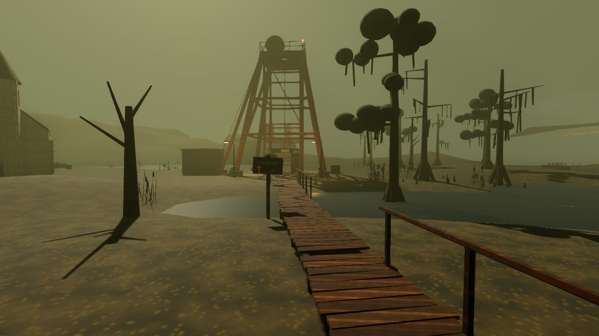<br><sub><b>SWAMP</b></sub></td>
    <td width="33%">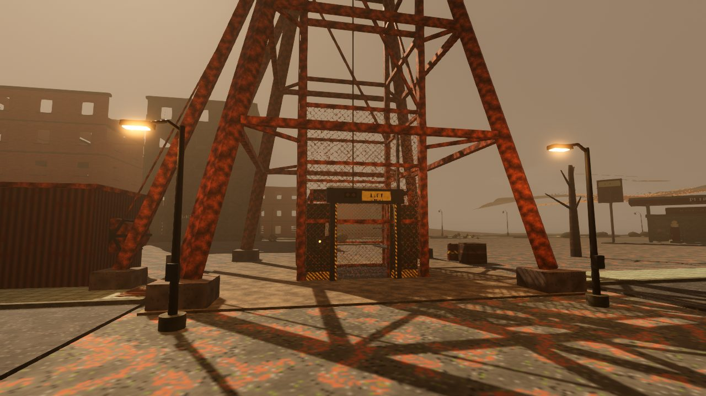<br><sub><b>DEAD TOWN</b></sub></td>
  </tr>
</table>

**Once an assignment the route offers a landmark stop** (`MAP` tags it). The first is **the dam**: the valley behind the station is walled off by a concrete arch 44 m high, the spillway roaring down its face into the stilling basin, the powerhouse at its foot. Climb the stair tower to the crest road for the view over the reservoir. Down the lift are the powerhouse galleries: turbine halls, the control room, and in one of the generators the windings worth a fortune. At 18:00 the sluices open and the galleries flood, one after another.

**Most stations have a landmark** worth the walk: a **chapel** with its bell tower and graveyard, a **fire lookout** you can climb for the view, a **farm** with its barn and silo, a **filling station**. Each has a safe or strongbox you can pry open, if you don't mind the noise.

<table>
  <tr>
    <td width="50%">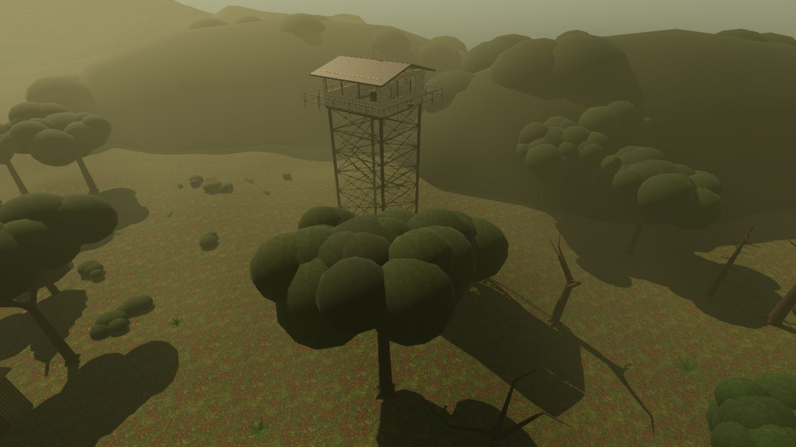<br><sub><b>FIRE LOOKOUT</b> · climb it for the view</sub></td>
    <td width="50%">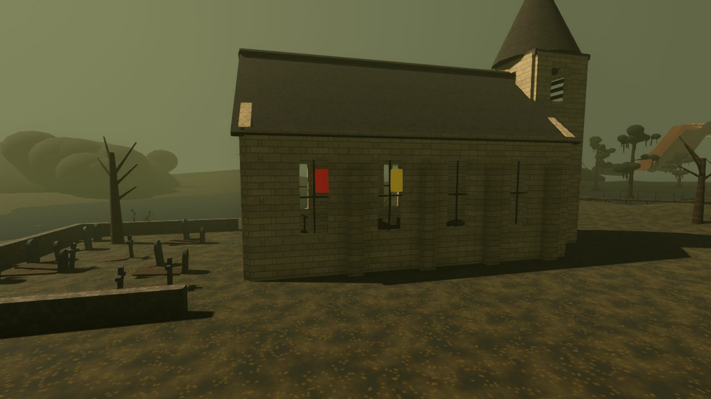<br><sub><b>CHAPEL</b> · bell tower and graveyard</sub></td>
  </tr>
</table>

**Down below,** every facility is generated from the station's seed, and they're big: a core of rooms round the lift, then wings strung out down long tunnel corridors, so the far end of a site is a couple of hundred metres from the lift and a crew that splits up is truly on its own. There are big halls with set pieces of their own, and a lower floor (B-2) of boiler rooms, pipe galleries and flooded stores reached by pits and stairwells. There are four kinds (FACTORY, LAB, FLESH and BACKROOMS), each with its own rooms, light, hazards and residents.

- **The vault:** the furthest dead end, behind a steel door. Only the vault keycard opens it, and the keycard is somewhere far away (it glows red, and your scanner finds it). Gold, cash, bonds and a heavy prize.
- **The records room:** behind a keypad door. Its four-digit code isn't on any map; it's chalked on a wall somewhere else on the site. Find it, read it out to whoever's on the train terminal, and they open it with `OPEN_BULKHEAD`.
- **The twin-key blast door:** two levers on opposite walls, to be pulled at the same time. Bring a friend, or jam one down with a door wedge and run.
- **Hazards:** flooded rooms with live cables, toxic gas (carry a gas mask), burst steam lines. **Events:** power failures (find the main breaker), tremors, airdrops under a red flare.

<table>
  <tr>
    <td width="50%">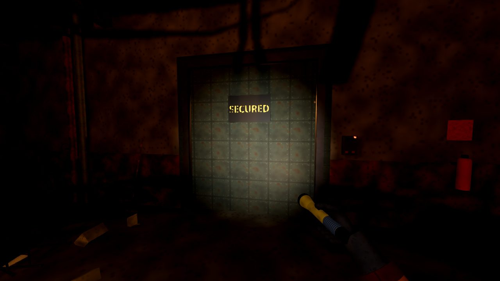<br><sub><b>RECORDS ROOM</b> · the code's chalked somewhere else</sub></td>
    <td width="50%">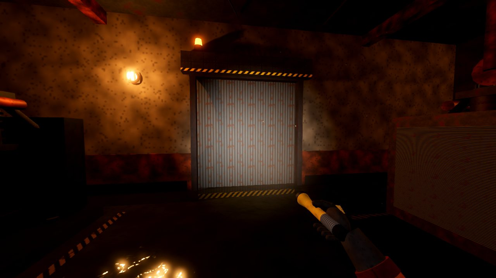<br><sub><b>LOCKDOWN</b> · the shutters come down from 20:00</sub></td>
  </tr>
</table>

- **It changes as the day goes on.** In the afternoon a water main can burst and flood a room around you. From 20:00, security lockdowns bring the fire shutters down and cut the place into sectors for a minute and a half. At 23:00 the lift's motor burns out and it crawls on its emergency drive, so don't leave it late.
- **Something paces the fear.** It watches how frightened the crew is: quiet stretches, then steps behind the one who's alone, a whisper, a door slamming two rooms over, the lights dying, and then whatever hunts by ear coming to look. After a real fright, it gives you a breather.


## Gear and upgrades

Order from the terminal (`SHOP`, `BUY MEDKIT 2`); orders arrive on a pump handcar at the back of the train. The **charging rack** on the crew car's back wall (hold E) tops up every battery you carry, the helmet cell and the shotgun's shells.

| Item | Price | |
|---|---:|---|
| Flashlight / Lantern | 35 / 55 | A beam, or light all round you. Run on batteries. |
| Scanner | 90 | Equipment. **F** sends out a pulse: scrap, creatures and the breaker light up through walls, with names and values. |
| Backpack | 80 | Equipment. One more slot. |
| Crowbar / Fire axe | 45 / 85 | Quick light hits, or slow heavy ones. |
| Shotgun / Shells | 240 / 30 | Six pellets a shell, holds four, heard across the site. |
| Medkit | 40 | Back to full health. |
| Road flare | 15 | Strike and throw: red light for a minute. |
| Noisemaker | 25 | Wind and throw: it rings, and anything that hunts by sound goes to it. |
| Adrenaline | 35 | Twenty seconds of breath that doesn't run out. |
| Door wedge | 20 | Jams a swing door shut: things have to break it down. |
| Walkie-talkie | 50 | Talk to anyone carrying one, at any range. |

**Upgrades** are permanent for the run, bought at a checkpoint (`UPGRADES`, `BUY_UPGRADE`). Several show up on the train or on your suit.

<details>
<summary><b>All 19 upgrades</b></summary>
<br>

| Upgrade | Price | |
|---|---:|---|
| BETTER_BOOTS | 215 | Double stamina. |
| WEATHERVANE | 150 | `VIEW_STATION` shows the weather. |
| MINIMAP | 375 | A HUD minimap underground and the `MINIMAP` site map. |
| STORAGE_CAR | 250 | A walk-in cargo car behind the crew car. |
| QUICK_DELIVERY | 120 | Deliveries in five seconds, not twenty. |
| BATTERY_PACK | 140 | Lights last 60% longer. |
| DIGITAL_CLOCK | 90 | A segment display with a countdown to departure. |
| GAS_FILTER | 120 | Gas can't touch you. |
| ACID_SHIELD | 110 | Acid rain runs straight off. |
| HEADLAMP | 160 | A lamp on the helmet, **T**. |
| NIGHT_VISION | 600 | Goggles on the helmet, **N**. |
| ARMORED_SUIT | 300 | A quarter less damage. |
| INFIRMARY | 180 | Heal back to full aboard. |
| CARGO_HARNESS | 220 | One more hand slot. |
| SIGNAL_BOOSTER | 140 | The scanner reaches 26 m, and is ready sooner. |
| LIFT_MOTOR | 150 | The Bureau's winch truck: lifts run twice as fast. |
| OVERTIME_PERMIT | 250 | The train leaves at 01:00. |
| MARKET_CONTACTS | 200 | 15% more for everything you shred. |
| SOFT_SOLES | 170 | Your footsteps carry half as far. |

</details>

## The terminal

The terminal has history (↑ ↓), Tab completion, usage hints as you type and *did you mean* for typos. The train's own CRT mirrors it.

<details>
<summary><b>Every command</b></summary>
<br>

| Command | |
|---|---|
| `HELP` | Every command. |
| `LEAVE_CHECKPOINT` | Take the next assignment. |
| `MAP`, `VIEW_STATION <letter>`, `ROUTE_TO <letter>` | The route, a station's details, set off (`ROUTE_TO CHECKPOINT` after three stops). |
| `BALANCE`, `MARKET` | Credits; the quota and today's prices. |
| `SHOP`, `BUY <item> [n]` | Order gear. |
| `UPGRADES`, `BUY_UPGRADE <name>` | Upgrades (at a checkpoint). |
| `STOCK`, `STOCK SELL <res\|ALL>`, `STOCK SUBMIT <res\|ALL>` | The bonded stock. |
| `SCAN_TRAIN`, `SCAN_SURFACE`, `SCAN_FACILITY` | What's where, in resources. |
| `OPEN_BULKHEAD <code>`, `CLOSE_BULKHEAD <code>` | The facility's bulkheads (the vault takes the keycard). |
| `LIST_CAMS`, `VIEW_CAM <n>`, `NEXT_CAM`, `PREV_CAM`, `TOGGLE_LIGHT`, `EXIT_CAMS` | The security cameras (arrows pan). |
| `MINIMAP`, `EXIT_MINIMAP` | The site map (with the MINIMAP upgrade). |
| `STATUS` | The crew's health and what they carry. |
| `LIST_LOGS`, `READ <log>` | Data disks you've found and uploaded. |
| `GUIDE [name]` | The field guide. |

</details>

## Controls

| Key | |
|---|---|
| **WASD** · **Shift** · **Ctrl** · **Space** | Move · sprint (7 s of stamina) · crouch (silent) · jump |
| **E** (hold for some) | Pick up, use, call and ride the lift, pry crates, override a bulkhead (loud), reset the breaker |
| **LMB** / **RMB** | Use what you're holding (switch a light, swing, fire, throw); equip equipment |
| **F** or **middle mouse** | Scan (with the scanner equipped) |
| **1–7**, **wheel** | Choose a slot |
| **T** / **N** | Headlamp / night vision (upgrades) |
| **Q** / **C** | Drop the item / drop the equipment (heavy things are set down) |
| **V** | Push-to-talk (if set) |
| **Esc** | Pause menu and settings; leave the terminal |
| **F11**, **Alt+Enter** | Fullscreen (Cmd+Ctrl+F on a Mac) |

Every key can be rebound in SETTINGS → CONTROLS.

## Saves and settings

- **The run saves itself** on arrival at each stop, every two minutes, and from the pause menu (SAVE & EXIT TO TITLE). **CONTINUE RUN** on the title screen picks it up where you left it. A host can continue a crew run; crewmates get back what they were carrying when they rejoin under the same name.
- **Photos** the Observer takes are kept in the pause menu's album, and can be pinned up in the train; the run-over screen lays them out as the run's memento.
- **Settings** (sensitivity, field of view, head bob, quality presets, volumes, voice, accessibility, key bindings) are in the pause menu and on the title screen.
- Everything is kept in `%APPDATA%\Godot\app_userdata\Downline\` on Windows and `~/Library/Application Support/Godot/app_userdata/Downline/` on a Mac.


## For developers

The whole project is in GDScript with no imported assets. **[HANDOFF.md](HANDOFF.md)** is the developer's guide: every system, the code map, conventions, the tests, the multiplayer architecture, building and releasing. Notes on the game that inspired it are in [docs/subterranauts-research.md](docs/subterranauts-research.md).

```bash
godot --path .                          # play
godot --path . -e                       # the editor
godot --path . -- playground LAB        # the playground: spawn creatures and items, god mode, events (TAB)
tests/all.sh                            # the headless suites, side by side
tests/mp.sh                             # multiplayer: two real processes over ENet
tools/export.sh release                 # build Windows + macOS and publish them as the latest release
```

Needs **Godot 4.7.2** (standard build) on PATH as `godot`; on Windows run the scripts from Git Bash. Publishing a release is how players get a new build: their games download it on the next launch.

<br>

<p align="center">
  <br>
  <sub><b>BUREAU OF RECLAIMED MATERIALS</b> · RAILNET FIELD SERVICE</sub>
</p>
